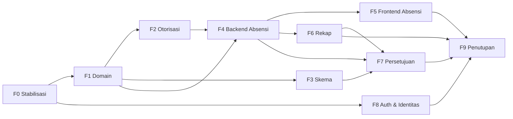

# Rencana Implementasi SiAbsen

Dokumen ini menjabarkan rencana implementasi untuk menutup seluruh kesenjangan yang
tercatat di [`ANALISIS_KESENJANGAN.md`](ANALISIS_KESENJANGAN.md). Rencana disusun
per **fase** yang dapat dirilis bertahap, dengan daftar berkas, langkah, dan **kriteria
penerimaan** terukur. Setiap fase diakhiri dengan pipeline hijau
(`composer lint:check`, `composer types:check`, dan `php artisan test`).

- **Diperbarui:** 11 Oktober 2026 (setelah `git pull`: komit `7708c36 Models`,
  `c156ebe update views`).

---

## 0. Status Progres Terkini

| Fase                            | Status                | Catatan                                                                                          |
| ------------------------------- | --------------------- | ------------------------------------------------------------------------------------------------ |
| F0 Stabilisasi & CI hijau       | **Selesai**           | Route terproteksi; `role` terisi; generics relasi + seeder diperbaiki; test & Pint/PHPStan hijau |
| F1 Fondasi domain               | **Sebagian (≈50%)**   | 10 model sudah ada; enum/cast, relasi `belongsToMany`, factory belum                             |
| F2 Otorisasi & peran            | **Belum**             | Belum ada policy/middleware                                                                      |
| F3 Integritas skema & migrasi   | **Belum**             | Check constraint & `attendance_requests` belum                                                   |
| F4 Backend absensi              | **Belum**             | Route masih Inertia statis, tanpa service                                                        |
| F5 Frontend absensi             | **Sebagian (mockup)** | UI ada, belum kamera/geolocation/backend                                                         |
| F6 Rekap & pencarian bertingkat | **Belum**             | Belum ada                                                                                        |
| F7 Alur persetujuan             | **Belum**             | Form izin masih `alert()`                                                                        |
| F8 Auth & identitas             | **Belum**             | Branding masih campur (EduPresence/starter kit)                                                  |
| F9 Penutupan (PostgreSQL/Docs)  | **Belum**             | Dokumen tertinggal (`school_settings`)                                                           |

> **Baru & kritis:** muncul **regresi keamanan** — `routes/web.php` kehilangan
> middleware `auth`/`verified`, sehingga dashboard & halaman domain terbuka tanpa login.
> Ini dimasukkan ke **F0** karena memblokir stabilitas.

---

## 1. Tujuan & Prinsip

1. **Hijau dulu, fitur kemudian.** Fase 0 mengembalikan test suite, lint, dan proteksi
   route sebelum menambah fitur.
2. **Satu sumber kebenaran.** Model Eloquent untuk perilaku data; migrasi untuk skema
   runtime; dokumen (`DATABASE.md`/`RANCANGAN.md`/`QUERY.sql`) disinkronkan setiap ada
   perubahan skema.
3. **Otorisasi di sisi server.** Setiap aksi domain dilindungi policy/middleware.
4. **Aturan domain diuji.** Jendela scan, keterlambatan, geofence, dan idempotensi
   memiliki test otomatis.
5. **Inkremental & dapat diparalelkan** sesuai pembagian peran (`RANCANGAN.md` §4).

---

## 2. Ringkasan Fase

| Fase   | Nama                                       | Prioritas | Bergantung pada | Hasil utama                                   |
| ------ | ------------------------------------------ | --------- | --------------- | --------------------------------------------- |
| **F0** | Stabilisasi, proteksi route & CI hijau     | Kritis    | —               | Route terproteksi; test/lint hijau            |
| **F1** | Selesaikan fondasi domain                  | Kritis    | F0              | Enum, cast, relasi, factory                   |
| **F2** | Otorisasi & peran                          | Tinggi    | F1              | Policy, middleware, gate                      |
| **F3** | Integritas skema & migrasi baru            | Sedang    | F1              | Check constraint, enum, `attendance_requests` |
| **F4** | Backend absensi (sesi, QR, scan, geofence) | Tinggi    | F1, F2          | Controller, route data, service               |
| **F5** | Integrasi frontend absensi                 | Tinggi    | F4              | Mockup menjadi fungsional                     |
| **F6** | Rekap & pencarian bertingkat               | Tinggi    | F4              | Halaman rekap + filter + ekspor               |
| **F7** | Alur persetujuan izin/koreksi              | Sedang    | F3, F4, F6      | Pengajuan & persetujuan                       |
| **F8** | Autentikasi & identitas aplikasi           | Sedang    | F0              | Registrasi/verifikasi, branding               |
| **F9** | Penutupan: PostgreSQL, PHPStan, dokumen    | Sedang    | Semua           | CI penuh & dokumen akurat                     |



---

## 3. Detail Fase

### F0 — Stabilisasi, Proteksi Route & CI Hijau (Kritis)

**Tujuan:** mengembalikan test suite, lint, **dan proteksi route** ke kondisi sehat.

**Langkah:**

1. **Pulihkan middleware.** Bungkus route domain dengan `middleware(['auth','verified'])`
   di `routes/web.php`; tambahkan middleware peran di F2.
2. **Perbaiki `User`:** masukkan `role` (dan `phone`, `birth_date`) ke `Fillable`/cast;
   casting `role` sementara boleh string lalu di-upgrade ke enum di F1.
3. **Perbaiki `UserFactory`:** isi `role` (default `Student`) + state helper
   `admin()`, `teacher()`, `student()`.
4. **Bangun aset frontend** (`npm install && npm run build`) agar test render punya
   manifest Vite.
5. **Pint:** jalankan `composer lint` (kini 5 berkas, termasuk `app/Models/User.php`).

**Berkas:**

- Ubah: `routes/web.php`, `app/Models/User.php`, `database/factories/UserFactory.php`
- Format: `app/Models/User.php`, `..._000006_*`, `..._000007_*`, `..._000010_*`,
  `database/seeders/DatabaseSeeder.php`

**Kriteria penerimaan:**

- `php artisan test` **0 failure, 0 error** (skip yang disengaja boleh).
- Tamu yang membuka `/dashboard` **dialihkan ke login** (test `DashboardTest` hijau).
- `composer lint:check` dan `composer types:check` hijau.

---

### F1 — Selesaikan Fondasi Domain (Kritis)

**Tujuan:** melengkapi model yang sudah ada dengan enum, cast, relasi, dan factory.
**Status:** 10 model sudah dibuat (`EducationLevel`, `SchoolClass`, `Subject`,
`StudentProfile`, `TeacherProfile`, `ClassStudent`, `TeacherAssignment`,
`AttendanceSession`, `AttendanceRecord`, `SchoolSetting`).

**Langkah:**

1. **Enum:** buat `App\Enums\UserRole` (`Student/Teacher/Admin`) dan
   `App\Enums\AttendanceStatus` (`Hadir/Terlambat/TidakHadir` + `Izin/Sakit` untuk F7),
   lengkap `label()`.
2. **Cast:** `User.role` → `UserRole`; `AttendanceRecord.status` → `AttendanceStatus`;
   `AttendanceSession.session_date` → `date`; koordinat → `float` (sebagian sudah ada).
3. **Relasi yang belum:**
    - `SchoolClass::students()` → `belongsToMany(User::class, 'class_students')` dengan
      `wherePivot('is_active', true)` dan `withPivot(['academic_year','is_active'])` +
      aksesoris `activeStudents()`.
    - Scope `ClassStudent::active()`, `TeacherAssignment::active()`,
      `AttendanceSession::onDate($date)`.
    - Tinjau penamaan `User::classMemberships()` agar konsisten (`classStudents()`).
4. **Factory domain:** buat factory untuk seluruh tabel domain dan sesuaikan seeder
   (opsional) untuk memakainya.
5. **Bersihkan `SchoolSetting`:** pakai di seeder/config atau hapus bila tak dipakai.

**Kriteria penerimaan:**

- Test: relasi & scope mengembalikan data benar (siswa aktif per kelas, sesi per tanggal).
- `AttendanceRecord.status` mengembalikan enum, bukan string.
- PHPStan hijau pada model baru.

---

### F2 — Otorisasi & Peran (Tinggi)

**Tujuan:** menegakkan hak akses berbasis peran dan relasi penugasan.

**Langkah:**

1. Helper `User::isAdmin()/isTeacher()/isStudent()`.
2. Middleware `EnsureRole` (alias `role`) dan terapkan pada grup route.
3. Policy: `AttendanceSessionPolicy`, `AttendanceRecordPolicy`,
   `AttendanceReportPolicy`, `ClassRoomPolicy`, `TeacherAssignmentPolicy`.
4. `Gate::before` agar `ADMIN` lolos semua policy.

**Kriteria penerimaan:**

- Guru A tidak dapat mengelola/melihat kelas guru B (403).
- Siswa tidak dapat mengakses rekap/kelola sesi (403).
- Admin dapat mengakses seluruh rekap.

---

### F3 — Integritas Skema & Migrasi Baru (Sedang)

**Tujuan:** menegakkan aturan integritas database dan menyediakan storage persetujuan.

**Langkah:**

1. Selaraskan strategi enum (native enum PostgreSQL + `check` setara untuk SQLite).
2. Aktifkan check constraint (`role`, `end_at > start_at`, `status`, `late_minutes >= 0`).
3. Perbaiki `academic_year` pada partial unique index (hindari pelanggaran keanggotaan aktif).
4. Migrasi `attendance_requests` (`session_id`, `student_id`, `requested_status`,
   `reason`, `evidence_path`, `status`, `reviewed_by`, `reviewed_at`).
5. **Sinkronkan dokumentasi:** masukkan `school_settings`, kolom geofencing, dan
   `academic_year` ke `.docs/QUERY.sql`, `.docs/DATABASE.md`, `.docs/RANCANGAN.md`
   (tandai status, hapus label **[rencana]** yang sudah tidak berlaku).

**Kriteria penerimaan:**

- `migrate:fresh --seed` sukses di SQLite **dan** PostgreSQL.
- Pelanggaran constraint ditolak (test negatif); dua baris aktif siswa sama ditolak.
- `QUERY.sql` berjalan via `psql --set=ON_ERROR_STOP=1` tanpa error.

---

### F4 — Backend Absensi: Sesi, QR, Scan, Geofence (Tinggi)

**Tujuan:** menyediakan controller/service/route nyata (menggantikan `Route::inertia`).

**Langkah:**

1. **Service `AttendanceService`:** `openSession`, `scan` (jendela scan, `HADIR`/`TERLAMBAT`
    - `late_minutes`, idempoten `firstOrCreate`), `computeAbsent` (TIDAK_HADIR read-time).
2. **Service `GeofenceService`:** Haversine + klasifikasi `SESUAI`/`DI_LUAR_RADIUS`/
   `TIDAK_TERVERIFIKASI` (pakai `school_settings`/`classes`).
3. **Controller:** `AttendanceSessionController`, `AttendanceScanController`,
   `StudentAttendanceController` (riwayat), `AcademicSearchController` (pencarian bertingkat).
4. **Form request:** `StoreAttendanceSessionRequest`, `StoreAttendanceScanRequest`.
5. **Route data** dengan middleware `auth/verified/role` + nama route untuk Wayfinder.
6. **Config `config/attendance.php`:** zona waktu `Asia/Jakarta`, toleransi menit,
   radius default, batas jendela.

**Kriteria penerimaan (Feature test):**

- Guru membuat sesi untuk assignment-nya; `qr_payload` unik.
- Scan dalam jendela → `HADIR`; lewat `start_at+15m` → `TERLAMBAT`; di luar jendela ditolak.
- Scan ganda → satu record.
- Jarak jauh → `DI_LUAR_RADIUS` dengan `distance_meters` wajar.
- `TIDAK_HADIR` muncul saat pembacaan bagi siswa aktif yang belum scan.

---

### F5 — Integrasi Frontend Absensi (Tinggi)

**Tujuan:** mengubah mockup statis menjadi fitur nyata.
**Status:** UI ada (`dashboard.tsx`, `auth/login.tsx`, `student/scanner.tsx`,
`student/permission.tsx`, `teacher/class-view.tsx`), tetapi statis.

**Langkah:**

1. Tambahkan pustaka QR (`html5-qrcode`/`@zxing/browser`) ke `package.json`.
2. **Scanner siswa:** ganti simulasi `Math.random()` dengan kamera nyata + kirim payload
   QR ke `AttendanceScanController`.
3. **Geolocation:** hook `useGeolocation` memakai `navigator.geolocation`; izin gagal →
   `TIDAK_TERVERIFIKASI`.
4. **Dashboard:** ganti data hardcoded dengan props dari backend; perbaiki deteksi
   `role` (pakai `UserRole` huruf besar) dan `types/auth.ts`.
5. **Tampilan guru:** tampilkan QR sesi nyata, timer jendela, monitor live (polling).
6. **Form izin:** ganti `alert()` dengan submit ke endpoint pengajuan (F7).
7. **Wayfinder:** ganti URL hardcoded (`/student/scan`, `post('/login')`, dll.) dengan
   `@/routes`.
8. Tinjau `resources/js/app.tsx` agar halaman domain memakai shell/layout yang tepat.

**Kriteria penerimaan:**

- Guru membuka sesi & menampilkan QR; siswa memindai dan menerima status instan.
- Pesan jelas saat di luar jendela atau izin kamera/lokasi gagal.
- `npm run types:check` dan `npm run check` hijau.

---

### F6 — Rekap & Pencarian Bertingkat (Tinggi)

**Tujuan:** halaman rekap (`RANCANGAN.md` §6) dan pencarian bertingkat (§1.6.1).

**Langkah:**

1. `ReportService`: agregasi per kelas/mapel/periode/siswa + `TIDAK_HADIR` on-the-fly.
2. `AttendanceReportController` + filter (jenjang → kelas → mapel → periode → siswa → status).
3. `AcademicSearchController`: kelas per jenjang, siswa aktif per kelas.
4. Frontend `reports/index.tsx` & `reports/search.tsx`: tabel, ringkasan, kecocokan
   lokasi + tautan peta, ekspor CSV.

**Kriteria penerimaan:**

- Filter bertingkat benar; ringkasan konsisten dengan data mentah.
- Ekspor CSV valid; otorisasi guru/admin diuji.

---

### F7 — Alur Persetujuan Izin/Koreksi (Sedang)

**Tujuan:** pengajuan izin/sakit oleh siswa dan persetujuan oleh guru/admin.

**Langkah:**

1. Model `AttendanceRequest` + enum status (`PENDING/APPROVED/REJECTED`).
2. `AttendanceRequestController` (store siswa, index/review guru).
3. Saat `APPROVED`, tulis/perbarui `attendance_records` (`IZIN`/`SAKIT`) + audit
   `reviewed_by`/`reviewed_at`.
4. Halaman pengajuan (siswa) & tinjauan (guru); integrasikan dengan form izin F5.

**Kriteria penerimaan:**

- Pengajuan tersimpan `PENDING`; persetujuan mengubah status + mencatat peninjau.
- Siswa tak dapat menyetujui pengajuannya sendiri.

---

### F8 — Autentikasi & Identitas Aplikasi (Sedang)

**Tujuan:** melengkapi akun dan menyatukan merek.

**Langkah:**

1. Aktifkan fitur Fortify sesuai kebijakan (`registration`, `emailVerification`,
   `resetPasswords`); selaraskan middleware `verified`.
2. **Unifikasi merek:** ganti "EduPresence" di halaman mockup menjadi "SiAbsen";
   set `APP_NAME=SiAbsen`; perbaiki `composer.json` name/description; perbaiki tautan
   `app-sidebar.tsx`; fallback appName di `app.tsx`.
3. Perbarui `resources/js/types/auth.ts` (`role`, `phone`, `birth_date`).
4. Perbarui `README.md` agar akurat.

**Kriteria penerimaan:**

- Nama "SiAbsen" konsisten di UI, `.env`, dan metadata.
- Tipe `User` frontend selaras payload Inertia; navigasi memakai `role` bertipe.
- README tidak menjanjikan fitur yang belum ada.

---

### F9 — Penutupan: PostgreSQL, PHPStan, Sinkronisasi Dokumen (Sedang)

**Langkah:**

1. Aktifkan `pdo_pgsql`; jalankan `migrate:fresh --seed` di PostgreSQL; uji
   constraint/index/FK. Tambahkan job CI PostgreSQL.
2. `phpstan analyse --memory-limit=1G`; perbaiki temuan level 7.
3. Finalisasi `.docs/QUERY.sql`, `.docs/DATABASE.md`, `.docs/RANCANGAN.md` (termasuk
   `school_settings`) + DBML.
4. Pastikan `composer ci:check` hijau end-to-end.

**Kriteria penerimaan:**

- CI SQLite + PostgreSQL hijau; PHPStan level 7 bersih; dokumen akurat.

---

## 4. Peta Berkas (Ringkas)

**Sudah ada — perlu ditinjau/dilengkapi:**

```
app/Models/{EducationLevel,SchoolClass,Subject,StudentProfile,TeacherProfile,
           ClassStudent,TeacherAssignment,AttendanceSession,AttendanceRecord,
           SchoolSetting,User}.php        # perbaiki fillable/cast, tambah scope/relasi
resources/js/pages/dashboard.tsx
resources/js/pages/auth/login.tsx
resources/js/pages/student/{scanner,permission}.tsx
resources/js/pages/teacher/class-view.tsx
resources/js/components/modal-peringatan.tsx
database/migrations/2026_10_11_110255_create_school_settings_table.php
routes/web.php                              # pulihkan middleware
```

**Dibuat:**

```
app/Enums/{UserRole,AttendanceStatus,AttendanceRequestStatus}.php
app/Policies/{AttendanceSessionPolicy,AttendanceRecordPolicy,
             AttendanceReportPolicy,ClassRoomPolicy,TeacherAssignmentPolicy}.php
app/Http/Middleware/EnsureRole.php
app/Http/Controllers/{AttendanceSessionController,AttendanceScanController,
                     StudentAttendanceController,AttendanceReportController,
                     AcademicSearchController,AttendanceRequestController}.php
app/Http/Requests/Attendance/{StoreAttendanceSessionRequest,StoreAttendanceScanRequest}.php
app/Services/{AttendanceService,GeofenceService,ReportService}.php
app/Models/AttendanceRequest.php
config/attendance.php
database/factories/*Factory.php
database/migrations/*_create_attendance_requests_table.php
resources/js/pages/reports/{index,search}.tsx
resources/js/pages/requests/{index,create}.tsx
resources/js/hooks/use-geolocation.ts
tests/Feature/Attendance/*.php
tests/Feature/Reports/*.php
tests/Feature/Authorization/*.php
```

**Diubah (lain-lain):**

```
config/fortify.php
resources/js/app.tsx
resources/js/components/app-sidebar.tsx
resources/js/types/auth.ts
.env.example
composer.json
README.md
.docs/{QUERY.sql,DATABASE.md,RANCANGAN.md}
```

---

## 5. Strategi Verifikasi & Definition of Done

Setiap fase dianggap **selesai** bila:

1. **Test:** seluruh test lulus, termasuk test baru untuk aturan yang disentuh.
2. **Negatif:** ada test yang membuktikan aturan **ditolak** saat dilanggar.
3. **Proteksi route:** route domain berada di belakang `auth`/`verified` + `role`.
4. **Lint & tipe:** `composer lint:check`, `composer types:check`, `npm run check`,
   `npm run types:check` hijau.
5. **CI:** `composer ci:check` hijau.
6. **Dokumen:** perubahan skema disertai pembaruan `.docs/*`.

**Perintah verifikasi cepat:**

```bash
composer lint:check
composer types:check
npm run check
npm run types:check
php artisan test
composer ci:check
```

---

## 6. Risiko & Mitigasi

| Risiko                                      | Dampak                               | Mitigasi                                         |
| ------------------------------------------- | ------------------------------------ | ------------------------------------------------ |
| Route domain tanpa proteksi (regresi)       | Data bocor; akses anonim             | Perbaiki di F0 sebelum fitur lain                |
| `pdo_pgsql` tidak aktif                     | DDL/constraint PostgreSQL tak teruji | Docker/service Postgres di CI (F9)               |
| Perbedaan enum PostgreSQL vs SQLite         | Lulus di test, gagal di prod         | Abstraksi enum + integration test.               |
| Partial unique index + `academic_year` NULL | Pelanggaran keanggotaan aktif        | Perbaiki di F3                                   |
| Kamera & geolocation butuh HTTPS            | Scanner gagal di lokal               | Akses via host/HTTPS; fallback input manual      |
| `F4` besar & sulit ditinjau                 | PR besar                             | Pecah: service → controller → UI                 |
| Akurasi GPS dalam ruangan                   | False `DI_LUAR_RADIUS`               | Konfigurasi radius + `TIDAK_TERVERIFIKASI`       |
| Keamanan QR (screenshot/titip absen)        | Kecurangan                           | TTL QR, rotasi payload, verifikasi lokasi & sesi |
| Merek campur (EduPresence vs SiAbsen)       | UI tidak konsisten                   | Unifikasi di F8                                  |

---

## 7. Urutan Pull Request yang Disarankan

1. **PR-1 (F0):** pulihkan middleware route + `role` di factory/model + Pint → CI hijau.
2. **PR-2 (F1):** enum + cast + relasi `belongsToMany`/scope + factory + test relasi.
3. **PR-3 (F2):** policy + middleware peran + test otorisasi.
4. **PR-4 (F3):** check constraint + `academic_year` + `attendance_requests` + sinkron dokumen.
5. **PR-5 (F4):** service absensi + controller + route data + test aturan domain.
6. **PR-6 (F5):** integrasi kamera QR + geolocation + dashboard/tampilan guru nyata.
7. **PR-7 (F6):** rekap + pencarian bertingkat + ekspor.
8. **PR-8 (F7):** alur persetujuan.
9. **PR-9 (F8):** auth lengkap + unifikasi branding SiAbsen + README.
10. **PR-10 (F9):** PostgreSQL di CI + PHPStan + finalisasi dokumen.

---

## 8. Checklist Pelacakan

- [x] **F0** Route terproteksi; `role` terisi; test & lint hijau
- [ ] **F1** Enum + cast + relasi `belongsToMany`/scope + factory (model sudah ada)
- [ ] **F2** Policy & middleware peran + test otorisasi
- [ ] **F3** Check constraint, enum selaras, `academic_year` aman, `attendance_requests`
- [ ] **F4** Service absensi + controller + route data + test aturan domain
- [ ] **F5** Scanner kamera + geolocation + dashboard/tampilan guru nyata (mockup → fungsional)
- [ ] **F6** Rekap + pencarian bertingkat + ekspor
- [ ] **F7** Pengajuan izin/koreksi + audit
- [ ] **F8** Registrasi/verifikasi email + unifikasi merek SiAbsen + README
- [ ] **F9** PostgreSQL di CI + PHPStan level 7 + dokumen final (`school_settings`)
